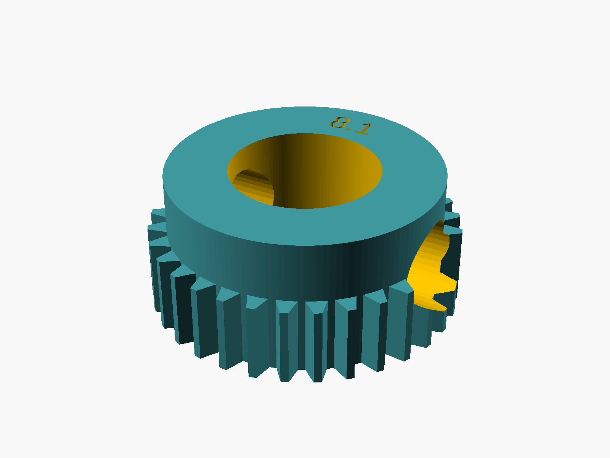
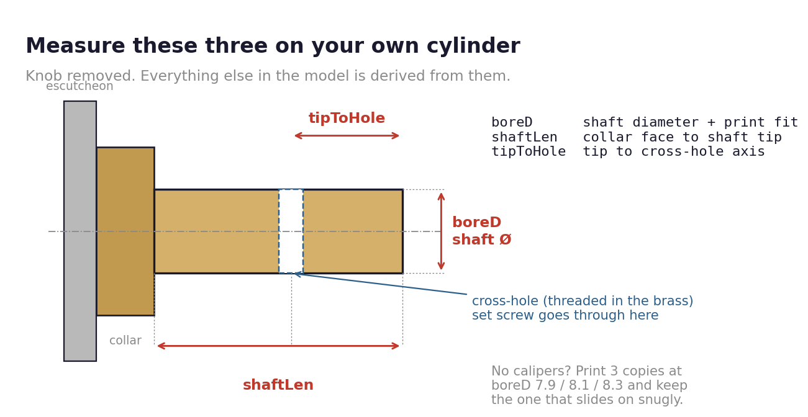
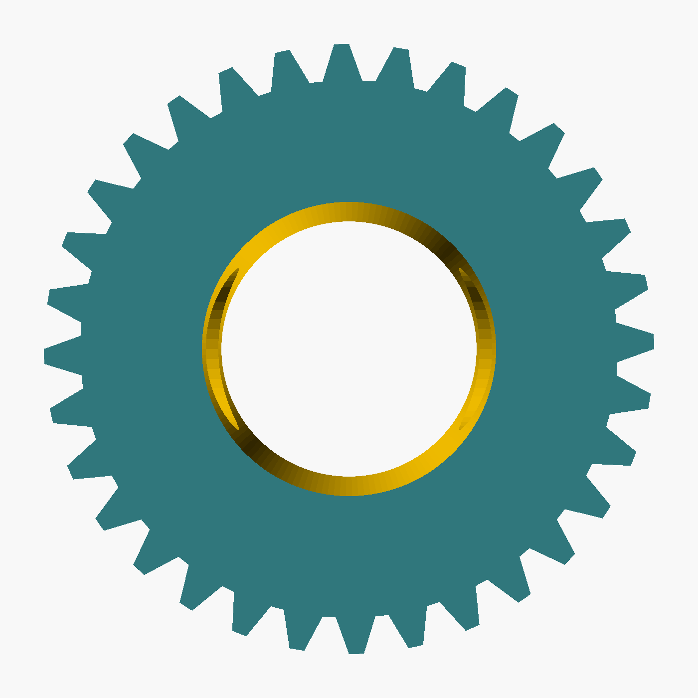
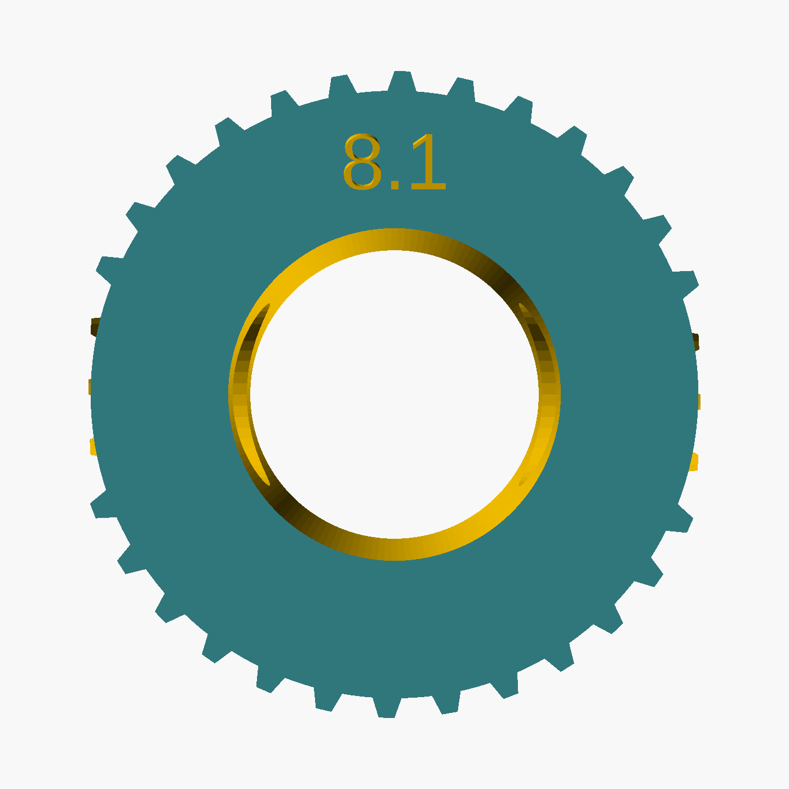

# Mul-T-Lock / Israeli Knob Cylinder Adapter

Lets a Nuki Smart Lock Ultra drive an existing geared knob cylinder (Mul-T-Lock style, common in Israel)
instead of the Nuki Universal Cylinder it ships with. A DIY, unofficial alternative to the "Nuki Ultra IL" kit
sold by [nuki.co.il](https://nuki.co.il); not made or supported by Nuki.

## What you need

- **Mounting plate A Europrofile Smart Lock Pro** from Nuki's
  [mounting plates page](https://nuki.io/en/products/spare-parts/mounting-plates-smart-locks). It clamps onto the
  part of the cylinder that sticks out of the door. The "Mounting Plate Smart Lock Ultra" bundled with the Ultra
  needs threaded holes these cylinders don't have.
- The printed adapter. It replaces the yellow Nuki gear and goes on the knob shaft instead of the knob.
- The set screw from your knob. It must be headless.

The Nuki Universal Cylinder isn't used.

## Measure

| Parameter   | What it is                             | Default |
|-------------|----------------------------------------|---------|
| `boreD`     | knob shaft diameter + print fit        | 8.1     |
| `shaftLen`  | collar face to shaft tip               | 7.5     |
| `tipToHole` | shaft tip to cross-hole axis           | 3.5     |
| `screwD`    | set-screw channel (M4 → 4.8, M3 → 3.8) | 4.8     |

If your numbers match the defaults, use the STL. Otherwise edit
[mtl-gear-adapter.scad](../mtl-gear-adapter.scad) and re-export.

No calipers? Print it with `boreD` 7.9 / 8.1 / 8.3 and keep the one that slides on snugly by hand. The bore is
engraved on the door-side face.

## Print

- FDM: [mtl-gear-adapter-fdm.stl](../mtl-gear-adapter-fdm.stl) (teeth −0.1 mm for nozzle bloat).
  Tested on a Bambu Lab A1 in PETG: 0.12 mm layers, 4 walls, 100 % infill, no supports, about 13 min.
- SLA / SLS / MJF: [mtl-gear-adapter.stl](../mtl-gear-adapter.stl). PA12 (MJF / SLS) is the best choice.

Use PETG, PA or ABS rather than PLA: a lock sees heat, load and years of cycles.

## Assemble

1. Remove the knob by undoing its set screw. Keep the screw.
2. Slide the adapter on with the teeth toward the lock and the engraved face toward the door.
3. Line up the channel with the cross-hole in the shaft and drive the set screw into the shaft's thread.
   - It must pass through the plastic freely by hand; the thread is in the brass only. If it binds, open the
     channel with a drill. Forcing it rounds out the hex socket.
   - When tight, it must sit below the bottom of the teeth, or it hits the Nuki gear.
4. Fit plate A, clip on the Nuki and run a calibration.

| Nuki side (teeth)                           | Door side (engraved)                       |
|---------------------------------------------|--------------------------------------------|
|  |  |

Keep your mechanical key with you until you've tested it on your door.

## Geometry

- 32-tooth star, OD 16.8 mm, 4.2 mm tooth band (same as the Keso / Abus adapters)
- smooth zone at the root diameter (14.8 mm) toward the door, total height 7.4 mm, through bore
- radial set-screw channel; the screw locks into the shaft's cross-hole, so nothing relies on friction
- standalone: the `Stern()` star polygon from [UB.scad](https://github.com/UBaer21/UB.scad) is re-implemented in
  the file, so it doesn't need `gear/ub.scad`
